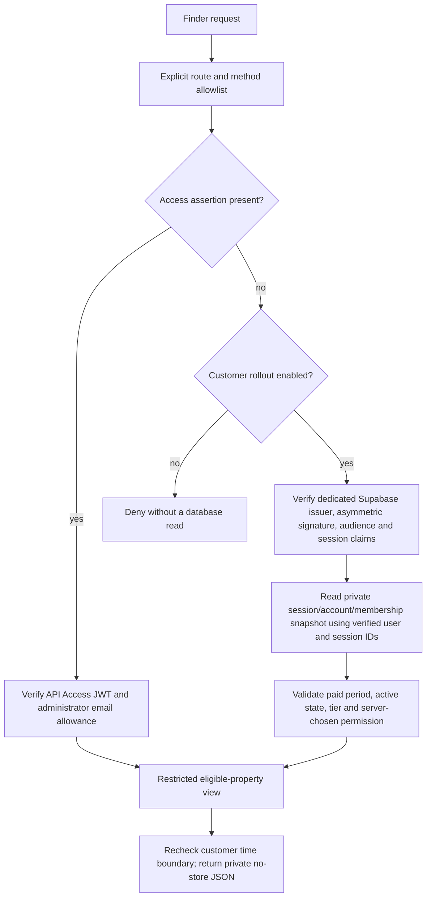

# Property Finder membership security — Phase 1

> Current implementation/preparation: see [Supabase-only cutover](property-finder-supabase-cutover.md). Access-dependent code, login routes and required bindings described below are historical; the replacement no longer trusts them. Keep the existing dashboard gate and rollback secrets until the staged verification/removal sequence is approved and completed.

Status: application implementation remains local/uncommitted and is not deployed. The revised database migrations 001/002 were separately applied on 29 October 2026 at 17:22 JST; see [the production receipt](property-finder-membership-migration-results.md). The owner subsequently completed Supabase email/SMTP/redirect/session settings. Deployment preparation changes no production settings; Access, Hyperdrive and crawler configuration remain unchanged. Customer access remains disabled. No memberships or fake active accounts were created. Account-only deployment instructions are in the [Phase 2 checklist](property-finder-authentication-deployment.md).

Phase 2 extends this foundation with cookie-backed account authentication, separate private administrator roles and schema version 2. See [the Phase 2 implementation, rollout controls and operator actions](property-finder-authentication.md). Its Auth rollout does not activate paid customer listing access; existing Cloudflare Access remains in place.

## Current data routes and audit

| Surface | Data/access boundary |
| --- | --- |
| `GET /api/property-finder/properties` (optional trailing slash/query) | The only Finder inventory endpoint. Common authorization runs before the property loader. Returns the bounded eligible snapshot; browser filters, sorting and six-card pagination operate on that authorized response. Pagination/query parameters do not bypass authorization or expand SQL eligibility. |
| `GET /api/property-finder/login` | Cloudflare Access administrator verification only; fixed redirect to the protected search page, no property response. Customer tokens cannot use this as an administrator login. |
| Detail, map, saved-property/search, refund and alternate data paths | Not implemented. Catch-all handler returns 404; unsupported methods return 405. There is no separate Finder detail endpoint; cards link directly to the original source. Future routes must choose a server-side permission through `authorizeFinderRequest`. The route-inventory test fails if another Functions handler is added without review. |
| `/property-finder/search/`, `index.html`, RSC `.txt`, `/_next/` JS | Static access shell and presentation logic only. Live inventory is fetched after authorization, never imported during export or persisted in browser storage. The development fixture route remains development-only. An automated export guard checks HTML, RSC, JSON and JS for inventory, private artifacts, credential references and embedded tokens. |
| Browser-to-Supabase REST, GraphQL, RPC or SQL | No Supabase client/keys or database credentials exist in Finder client code. Supabase browser roles receive no paid-schema grants, even when authenticated. Membership does not grant a PostgreSQL reader role to a customer. |
| Public Directus `/properties/`, `/property/[slug]/`, accommodation and image files | Deliberately public CMS content, separate from the paid Finder inventory. Existing publication, image and sold-property styling rules are preserved. |
| Original municipal/portal listing and image hosts | Public third-party resources intentionally linked/hotlinked; this project cannot revoke copies or access obtained directly from those sources. |

Read-only production checks:

- Eight relations in `crawler`, `property_api` and `public`, and 17 RLS policies inspected. Crawler tables have enabled/forced RLS. The customer view is a security-invoker/security-barrier projection and retains the source/status/type/duplicate/geographic restrictions.
- `anon`, `authenticated` and `service_role` have no reachable paid relations, including column-level access. `anon`/`authenticated` have no reachable functions in the paid schemas. Public GraphQL is an invoker entrypoint, so it receives no additional table rights. The public `rls_auto_enable` function is an event-trigger helper, not a property-data RPC.
- The web login is non-superuser, NOBYPASSRLS, NOINHERIT and not a crawler-writer member. Existing read-only transactions, role checks, column-limited projection, five-second SQL timeout, 500-result bound and TLS connection validation stay intact. The crawler writer remains a separate role/credential and is not imported by website code.
- Hosted Hyperdrive uses the restricted reader, `verify-full`, its CA certificate and disabled query caching. Pages publishes tracked `out/` after `npm ci`; the new `postinstall` guard therefore also checks the actual deployment artifact. Normal `npm run build` checks it again after regeneration.
- The dedicated project currently advertises an ES256 public signing key. No key rotation or Auth configuration change was performed.
- The Pages production variables currently contain only the existing five administrator/database settings; there is no enabled customer feature flag.
- Limits of inspection: the restricted SQL session cannot confirm the Data API exposed-schema dashboard setting. Available Cloudflare credentials returned an empty account Access-app list and 403 for legacy zone Access/cache-rule inspection. Existing Access redirects were confirmed during the preceding release; **the owner must review the actual Access policies and zone cache overrides before customer rollout**. Nothing was broadened or bypassed to obtain these settings.

## Server-side authorization

`FINDER_CUSTOMER_ACCESS` is **unset/`disabled` by default**. Only the exact server binding `enabled` admits the customer path. Unknown values deny customers. This setting is never read from a URL, cookie, header or browser flag. Administrator requests remain available independently, including when customer configuration is missing or invalid. A bad Access assertion never falls back to customer authentication.

The customer verifier accepts only ES256/RS256 tokens from `https://<FINDER_DATABASE_PROJECT_REF>.supabase.co/auth/v1`, using that project's fixed JWKS endpoint. Audience must be exactly `authenticated`; the role must be `authenticated`, anonymous sessions are rejected, and signed user/session UUIDs plus issuance/expiry are validated. HS256 legacy shared secrets, service-role tokens, unrelated issuers/audiences, forged signatures and query-string tokens are not accepted. No service-role key is needed.

Token verification is not a membership or session-revocation check. Each request uses a **fresh server lookup** of the signed `sub` and `session_id`, joining the current Auth session and account to a private entitlement. Missing/deleted/revoked sessions, timeboxed expiry, disabled/banned/deleted/anonymous users, unpaid/past-due/inactive/canceled/refunded memberships, unknown tiers and expired/future paid periods deny access. Database failures or a missing schema/helper produce a generic 503 and never fall back to listings. Supabase describes the distinction between JWT expiry and checking `auth.sessions` in its [session documentation](https://supabase.com/docs/guides/auth/sessions).

JWT/user metadata, payment-success URLs, request account IDs and `is_subscribed`/tier flags are ignored. Membership state is not cached; only public verification keys are cached. The authorization grant expires at the earliest token, paid-period or session time limit, and the handler rechecks that limit after loading data. Concurrent revocation takes effect on the next request; an already authorized in-flight request is not a durable entitlement cache.

### Permissions

| Tier | Server permissions |
| --- | --- |
| Basic — planned ¥2,000/month | `listings:read`, `search:use` |
| Premium — planned ¥4,000/month | Basic plus `saved-properties:use`, `saved-searches:use`, `maps:read`, `refund:request-review` |
| Existing Access administrator | Existing independent administrator access |

These permissions prepare the boundary; they do not implement Premium features or billing. `refund:request-review` only permits requesting a future review. It never establishes purchase/refund eligibility, pays money, or promises an automatic three-month refund. The later verified agency-purchase workflow must enforce the stated eligibility and maximum of three paid Premium months. Trusted billing code must map approved payment-provider price IDs to the tier; no client-supplied amount/tier can establish payment.

All API responses, including denials, set private/no-store browser and CDN headers, no-cache/expiry headers, `Vary: Authorization, Cf-Access-Jwt-Assertion, Cookie`, same-origin resource policy and no CORS allowance. No ETag, cache API, 304 data path or persistent client inventory cache is used. A CDN rule must not override these controls; Hyperdrive membership query caching must stay disabled. Already viewed/downloaded data cannot be recalled from an authorized user's browser.

## Database migration — revised and applied

See [the review-only SQL proposal](../sql/proposals/001_finder_membership_foundation.sql) and [the compatibility revision/recovery report](property-finder-migration-compatibility.md).

It creates an unexposed `finder_security.memberships` ledger with forced RLS and deny-by-default account/payment/status fields. It seeds no rows. The application has no membership write grants and no new service-role or writer credentials. A future separately reviewed billing writer must be isolated from both website reads and the crawler writer.

The compatibility revision uses the existing postgres administrator as the owner of private fixed-query helpers, following Supabase’s supported pattern. It adds no managed Auth grants, ownership changes or RLS policies. No custom helper-owner role is created; existing postgres Auth reads and RLS bypass are prerequisites, not new grants. Only the web login receives EXECUTE on the fixed-search-path `SECURITY DEFINER` lookup. That helper reads only account/session status and the requested user's ledger row; it exposes no Auth email, password/token fields, payment details or private property facts. The web login receives no direct Auth/ledger table access and customers receive no helper/schema grants. Server token verification binds the helper arguments; it is never a public RPC for arbitrary IDs.

The revised proposals have now been applied and verified in production; do not replay them. See the application receipt above. Phase 2 also execution-tests both SQL proposals in disposable in-memory PostgreSQL using PGlite, including helper-owner isolation, browser-role denial and unchanged property/reader/writer fixtures. The stronger compatibility fixture models non-superuser postgres and protected Auth ownership. The owner explicitly skipped a disposable hosted test; production application subsequently succeeded after backup confirmation. Preserve existing grants, RLS, membership/writer separation, backups and migration checksums. Do not replay or edit crawler migrations.

## Before customer enforcement may be activated

1. Review the already-applied migration receipt and preserve its checksums; do not rerun 001/002. Production verification confirmed both snapshots, empty private tables, public-role denial and unchanged eligible-listing/crawler permissions. Local migration tests also exercise managed ownership restrictions; they do not replace real hosted lifecycle acceptance.
2. Deploy and test the separately reviewed Phase 2 account flow using the [account-only checklist](property-finder-authentication-deployment.md). The owner has configured email/SMTP/redirect/session settings; real email, refresh/signout and account-deactivation tests remain acceptance actions. The foundation checks session existence and `not_after`; test any additional inactivity/single-session policies chosen for launch. Phase 2 already clears displayed data on signout/account switch and reauthorizes at expiry.
3. Implement separately reviewed billing synchronization with authoritative paid-through/tier state, verified events, replay/idempotency handling, renewals, cancellations, failed payments, refunds and revocation. Provision no fake production entitlements and do not use the crawler writer or browser metadata.
4. Implement each Premium endpoint with a server-chosen permission and verified-user ownership. Add saved-data schema/RLS tests before those features exist. Do not expose the private property or membership schemas via Data API grants.
5. Review the existing Access applications and zone cache rules with appropriate dashboard permissions. Choose a controlled customer edge route/policy without removing administrator protection or opening an unguarded data path. Reconfirm exposed schemas and direct REST/GraphQL/RPC denial.
6. Only after staging passes, explicitly approve enabling `FINDER_CUSTOMER_ACCESS=enabled`. Enabling early fails closed because there is no helper/paid ledger. Unset/disable the flag to stop customer requests while preserving administrator access. No public launch, production settings change or deployment is part of Phase 1.

## Validation

Run `npx tsc --noEmit`, changed-file ESLint, `node --import tsx --test tests/*.test.ts`, the normal production build and Pages Functions compilation. The new security suite covers disabled rollout, missing/invalid/expired credentials, both asymmetric algorithms, role/audience confusion, expired/unpaid/revoked memberships, account/session mismatch, Basic/Premium capabilities, spoofed IDs/flags, administrator preservation, no fallback, per-request refresh, in-flight expiry, cross-origin/alternate-route denial, response-cache headers and static inventory leaks. Synthetic keys/records exist only in tests, not runtime configuration or deployed assets.

Primary references: [Supabase signing keys](https://supabase.com/docs/guides/auth/signing-keys), [Data API security](https://supabase.com/docs/guides/api/securing-your-api), [RLS and invoker views](https://supabase.com/docs/guides/database/postgres/row-level-security).
